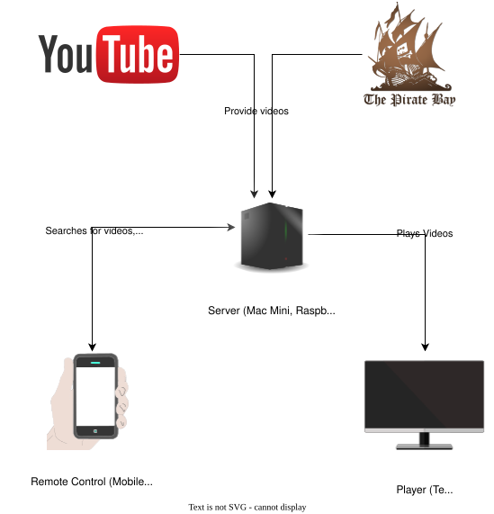
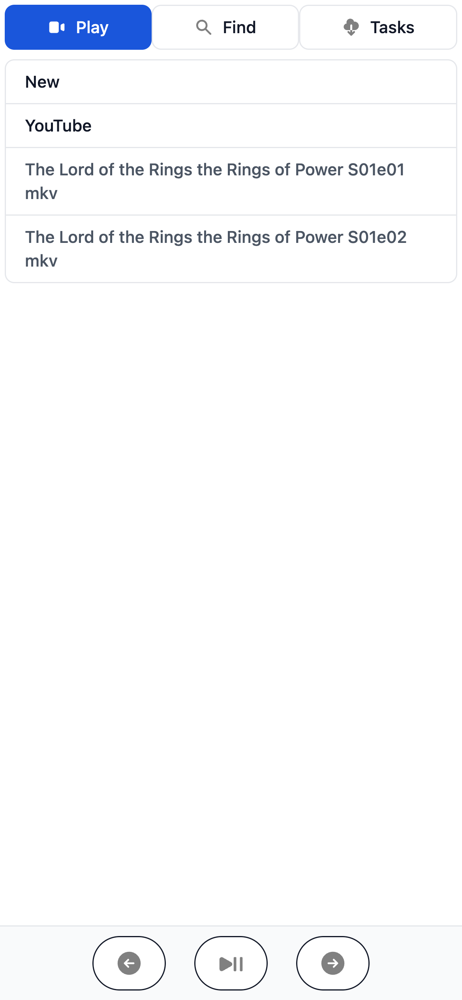
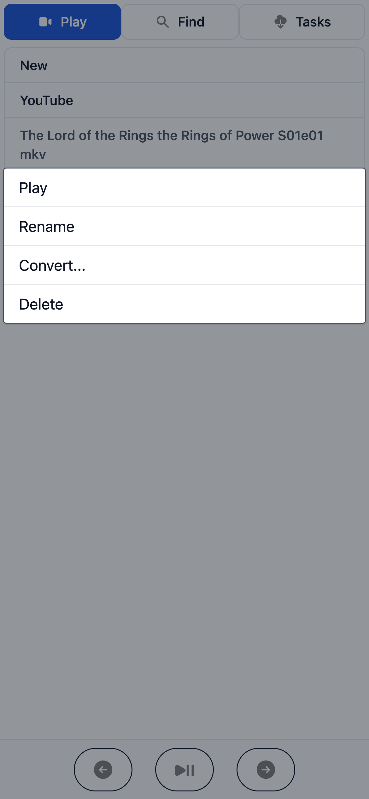
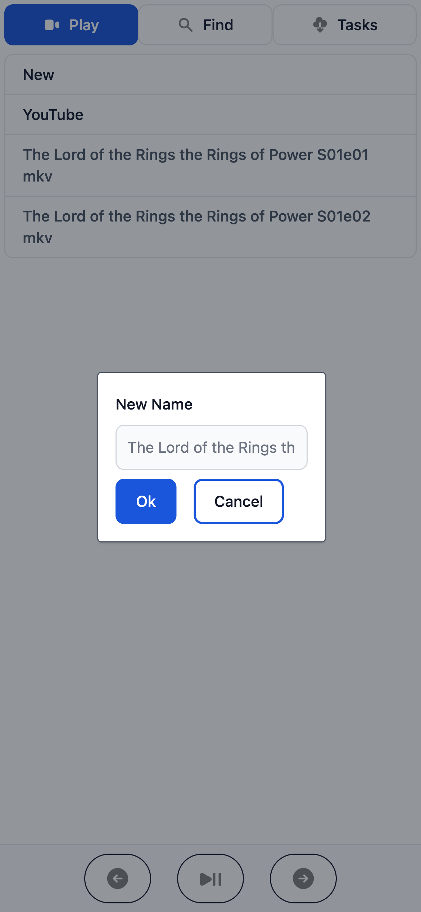
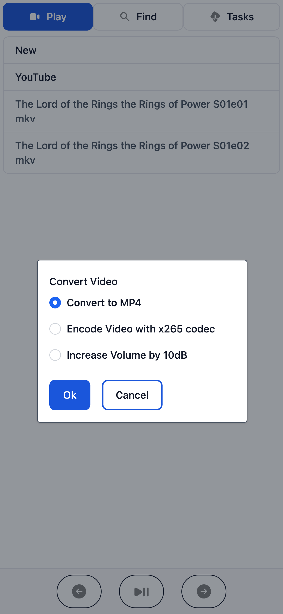
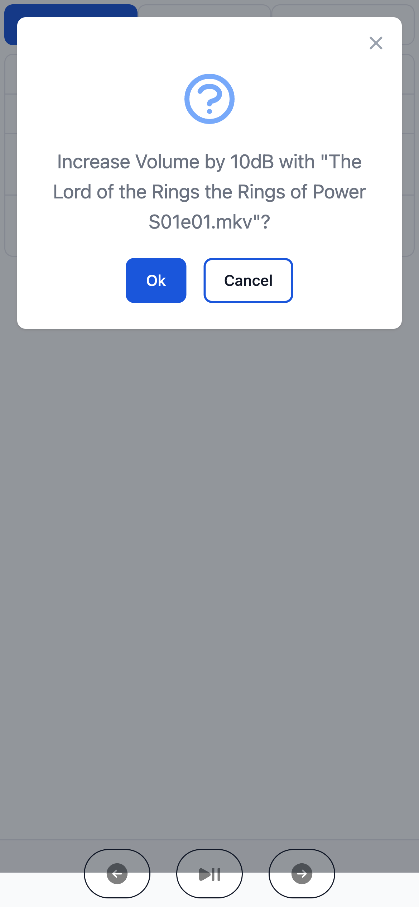
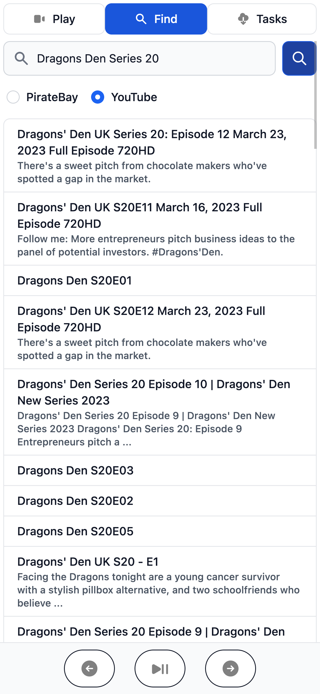
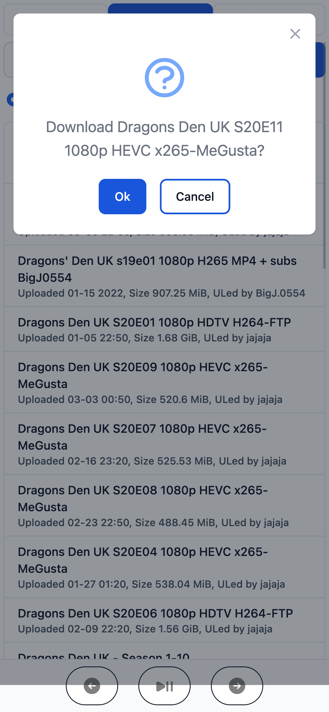
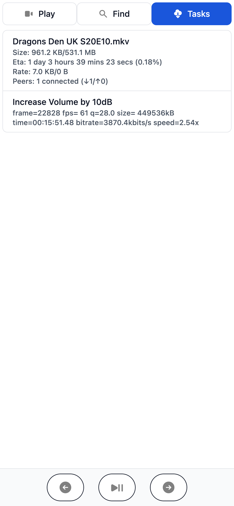

# TV Server

## Introduction

TV Server 
- provides ad free viewing of videos published on the public internet.
- connects Youtube to your TV and lets you control them with your mobile phone.
- manages a local library of PDF and EPUB books alongside the video library.
- is a thin wrapper around [FFmpeg](https://ffmpeg.org/), 
[yt-dlp](https://github.com/yt-dlp/yt-dlp) and [Transmission](https://transmissionbt.com/)

Architecturally, it consists of 3 components:

- The remote control, which is a web app that acts as a remote control
- The player, which is a web app that runs on the TV
- The server, which is a daemon that hosts the player and remote control apps and handles downloading 
and serving videos and books;



It has been tested on macOS and Debian Bullseye.

## Setup

The easiest way to get started is with docker compose. 

First you must create a file called `.env` in the root of the source directory that will contain
values for the required environment variables. There is a sample `.env` file called `env.sample`
that contains suitable values for running docker compose on macOS. `GOOGLE_KEY`
is optional ([see below](#obtaining-a-google-api-key)).

```shell
$ cp env.sample .env
$ export UID
$ docker compose up
```
YouTube search uses yt-dlp's `ytsearch` when `GOOGLE_KEY` is unset. If a key is
configured, search uses Google's official API. Keyless search does not require
a developer key, but YouTube changes and rate limits can require yt-dlp updates.

### YouTube download dependencies

Downloads require FFmpeg, Python 3.10 or newer with pip, and Node.js 22 or newer
on the server's `PATH`. On startup, the server selects a Python interpreter
that can run pip, installs yt-dlp and its challenge solver dependencies into
`$DOWNLOAD_DIR/.yt-dlp-python`, and runs downloads with that interpreter. Set
`TVSERVER_PYTHON` to an absolute interpreter path if needed. The downloads
directory must be writable by the service user.

To install the same dependencies manually into that directory:

```shell
export DOWNLOAD_DIR=/path/to/downloads
python3 -m pip install --upgrade --target "$DOWNLOAD_DIR/.yt-dlp-python" "yt-dlp[default]"
```

The Docker image includes these dependencies; rebuild it after updating the
Dockerfile. A supported Deno installation can also be used because yt-dlp
enables it by default.

Updating bare `yt-dlp` does not install the JavaScript challenge solver. Keyless
search uses the same runtime as downloads; official API search is independent.
See the [yt-dlp JavaScript setup guide](https://github.com/yt-dlp/yt-dlp/wiki/EJS).

To verify the download command without contacting YouTube, run the regression
test after yt-dlp is installed in the downloads directory:

```shell
cargo test --no-default-features --features webserver --lib downloads_one_file_with_a_fixed_output_name -- --ignored
```

### Android playback and downloads

Android uses an embedded LibVLC player, including MKV and E-AC-3 decoding,
seeking, track selection, playback speed and saved resume positions. Tapping a
video opens immersive landscape playback. Controls hide after three seconds of
playback and reappear when the screen is tapped; paused controls stay visible.
AV1 files use VLC's software decoder to avoid the audio/video timing mismatch
observed with MediaCodec on Samsung devices. Other codecs retain hardware
decoding and VLC's existing fallback. Android YouTube downloads prefer H.264/AAC
when available, with the previous format fallback for sources without H.264.
This also reduces the need for software decoding on future downloads.
The library returns to the phone's orientation and respects system bars and
display cutouts. The APK
bundles Python 3.12, FFmpeg/FFprobe, QuickJS, and the official yt-dlp executable
with its EJS solver. No device-side pip installation or Google API key is needed.
The pinned yt-dlp version, source URL and SHA-256 are in
`gen/android/app/src/main/assets/ytdlp/version.json`; dependency notices are
packaged alongside it. Runtime data stays in app-private storage.

User-started yt-dlp downloads (YouTube and SoundCloud) and torrent downloads keep
running when the screen turns off or the app is backgrounded. Each transfer
acquires Android execution before starting the engine, including magnet metadata
lookup. Android 14 and newer use
[user-initiated data transfer jobs](https://developer.android.com/develop/background-work/background-tasks/uidt),
which provide the transfer's CPU lifetime without the six-hour limit of modern
`dataSync` foreground services. Android 7–13 use a download foreground service
with a partial wake lock. The Downloads notification shows progress and offers
cancellation. Its notification permission is requested on the first download;
declining it still allows background execution.

Completing, failing or cancelling a download releases its execution slot without
interrupting other transfers. Android system stops are reported as terminal task
errors. Force-stop, reboot and recovery after process death are separate from
screen-off execution; download queue restoration is not implemented.

Video is the default for every new playback session. The native player has
independent **Video / Visualizer** controls and a **Keep audio playing with screen
off** switch, initially off. With that switch off, locking the phone or leaving
the player pauses playback. With it on, Back returns to the library while audio
continues. The notification and lock-screen controls provide play/pause, seeking,
and Stop. **Stop** in the player also releases the decoder and playback service.
Unlocking or reopening the player reconnects to the same session; it does not
automatically resume a paused video.
Selecting a completed video again starts it from the beginning, including older
saved positions at the end of a file. Unfinished videos keep their resume position.

Open **Playback settings → Audio sync** to correct audio timing while watching.
Choose **Earlier** when sound follows the picture, or **Later** when sound leads
it. Each step adjusts audio by 50 ms, up to five seconds in either direction.
The correction is saved on this device and restored for subsequent videos and
playlist items. **Reset** restores the default timing. This is an adjustable
correction; automatic compensation for a particular speaker or Bluetooth device
still depends on its reported output latency.

`NativePlaybackService` owns the single LibVLC player, Android `MediaSession`,
audio focus, foreground notification and playback wake lock. The Activity only
attaches its video surface and controls. Transient focus loss pauses and resumes
on focus return unless the user paused in the meantime; permanent focus loss and
headset removal pause. Screen-off playback disables video output. Display changes
keep the media, position, pause state, rate, volume and audio track intact.

The visualizer uses Android's `Visualizer` effect on an explicitly allocated,
nonzero LibVLC AudioTrack session. It reads this player's decoded PCM output;
there is no microphone capture, global-output capture, or second audio player.
Android requires `RECORD_AUDIO` permission for this effect, requested when the
user first chooses Visualizer. Declining permission keeps Video selected. If
analysis is unavailable, the player returns to Video with an explanation.
Capture and rendering stop while paused or hidden. The local renderer reuses
the frontend's classic visualizer, including reduced-motion support, in a WebView
that can load only bundled assets. `android-build.sh` regenerates those assets
using `scripts/build-android-visualizer.mjs` in the frontend repository.

The service follows Android's [background playback lifecycle guidance](https://developer.android.com/media/media3/session/background-playback)
using the platform media-session interface compatible with LibVLC, rather than
replacing its codec stack with ExoPlayer. See also Android's
[foreground-service types](https://developer.android.com/develop/background-work/services/fgs/service-types#media),
[audio-focus guidance](https://developer.android.com/media/optimize/audio-focus),
and [session-scoped Visualizer contract](https://developer.android.com/reference/android/media/audiofx/Visualizer).
The AudioTrack session option is supported by [VLC's audio output](https://mailman.videolan.org/pipermail/vlc-commits/2018-February/047694.html).

On each Android cold start, a background task checks the official stable GitHub
release and fetches a newer Python payload, including its EJS solver. It checks
the release's SHA-256 and tests imports against the bundled Python before
activating the update. Running searches/downloads retain their original script;
new ones use the update immediately. The checked update persists across restarts,
while offline, failed or incompatible updates leave the last working copy (or the
APK's bundled version) available. Python, QuickJS and FFmpeg still update with the
APK. This updater is Android-only and does not affect the web UI or server setup.

Build from the frontend repository using JDK 21:

```shell
./android-build.sh --debug --target aarch64 --apk --ci
```

Android's Rust shared library is linked with 16 KB page alignment, matching the
VLC and downloader SDK prebuilts. Check the actual APK after building (from this
backend directory):

```shell
python3 tests/android_apk_alignment.py gen/android/app/build/outputs/apk/universal/debug/app-universal-debug.apk
```

The downloader SDK's `libpython.zip.so` and `libffmpeg.zip.so` are ZIP data
archives, so they have no ELF segments to align. Executable `.so` files must all
pass this check. Also verify APK ZIP alignment with Android Build Tools'
`zipalign -c -P 16 4 <apk>`.

On-device regression tests are in `gen/android/app/src/androidTest`. The Android
project keeps APKs installed after instrumentation tests to preserve emulator
user data; do not override `android.injected.androidTest.leaveApksInstalledAfterRun`.
Test-only helper activities are excluded from Recent apps so their blank windows
cannot be reopened as if they were the real app. After instrumentation, start
MainActivity and check the actual return path (with `adb` on your PATH):

```shell
adb -s emulator-5554 shell am start -W -n com.abamaxa.lots_of_videos/.MainActivity
python3 tests/android_recents_smoke.py
```

When finished, remove only the test package with
`adb -s emulator-5554 uninstall com.abamaxa.lots_of_videos.test`.
Keep the main `com.abamaxa.lots_of_videos` package installed to preserve its library.

The playback-session regression tests cover default pause on power-button lock,
opt-in audio while locked, Activity destruction/reconnection, notification and
media-session controls, interruptions, display-state preservation, actual tone
versus silence analysis, and MKV/E-AC-3 decoding. After the normal Android build,
the test APK can be built without re-running Tauri's Rust bridge:

```shell
cd gen/android
./gradlew :app:assembleUniversalDebugAndroidTest -x :app:rustBuildUniversalDebug
adb -s emulator-5554 install -r app/build/outputs/apk/androidTest/universal/debug/app-universal-debug-androidTest.apk
adb -s emulator-5554 shell am instrument -w -r \
  -e class com.abamaxa.lots_of_videos.NativePlaybackSessionTest,com.abamaxa.lots_of_videos.NativePlayerUiTest \
  com.abamaxa.lots_of_videos.test/androidx.test.runner.AndroidJUnitRunner
```

The session tests use disposable files under the app's cache directory and grant
audio-analysis permission on the test device. They restore the device's media
volume and immersive tutorial setting. They never delete downloads or databases.
Audio/video sync tests compare the actual displayed picture with session-scoped
PCM analysis: green frames contain a tone and red frames are silent. H.264/AAC
and AV1/AAC fixtures cover initial playback, seeking and display changes. Generate
them with `tests/generate_native_av_sync_fixtures.sh` (FFmpeg with libx264 and
libsvtav1). These checks measure playback inside Android; physical speaker or
Bluetooth latency still requires listening on the device.
The opt-in `NativeAudioSyncListeningTest` plays a sample copied to
`cache/sync-listening-sample.mp4` in a disposable debug installation; run it with
the instrumentation argument `-e listen true`. It is skipped in the normal suite.
Create `cache/sync-listening-done` in that installation to finish the listening
check early. The probe does not change timing settings or decoder selection.
The protected headset-removal broadcast is simulated as the system UID on a
userdebug emulator; that one check is skipped on phones, where a physical
wired/Bluetooth disconnect should be verified.

Native task cancellation can be checked against a running debug app with Node 22+
and the Android SDK configured. This uses real Tauri IPC to cancel a disposable,
unresolved magnet and verifies repeated cancellation, without touching user tasks:

```shell
node tests/android_task_cancellation_smoke.cjs emulator-5554
```

Screen-off download protection can be checked against an idle debug app. The
smoke test backgrounds and locks the emulator, asks Android to reclaim disposable
background processes, and verifies the transfer and its CPU protection survive:

```shell
node tests/android_background_download_smoke.cjs emulator-5554
```

To also exercise real yt-dlp and torrent byte transfers, build the disposable
local seed peer and use `--transfers`. The test serves a throttled local video and
a local torrent, verifies both advance while locked, and cancels its own
transfers and removes its fixtures. This mode requires an Android emulator:

```shell
cargo build --no-default-features --features webserver --example android_download_seed
node tests/android_background_download_smoke.cjs emulator-5554 --transfers
```

`NativeDownloadsTest` checks real Android jobs/services, screen-off CPU wake
locks, progress notifications, independent cancellation and system-stop cleanup.

On an idle emulator, the playlist smoke test checks the real Tauri commands and
playlist UI, then restarts the app to verify SQLite persistence. It creates and
removes one temporary playlist and uses existing library references without
modifying their files:

```shell
node tests/android_playlists_smoke.cjs emulator-5554
```

## Configuration

The tvserver daemon is configured through the following environment variables

| Environment Variable | Description                                                                                   |
|----------------------|-----------------------------------------------------------------------------------------------|
| GOOGLE_KEY           | Optional official YouTube API key. If unset, search uses yt-dlp without a developer key.      |
| MOVIE_DIR            | *The directory where movies will be stored.                                                   |
| BOOK_DIR             | The directory where PDF and EPUB books will be stored; defaults to lowercase `books` beside `MOVIE_DIR`. |
| BOOK_THUMBNAIL_DIR   | The directory for book covers; defaults to `<BOOK_DIR>/.thumbnails`.                           |
| CLIENT_DIR           | The directory contain the client apps, defaults to `clients`                                  |
| TRANSMISSION_URL     | URL to access the Transmission HTTP interface                                                 |
| TRANSMISSION_USER    | Username to access the Transmission HTTP interface                                            |
| TRANSMISSION_PWD     | Password to access the Transmission HTTP interface                                            |
| TORRENT_DIR          | The directory where torrent files are saved.                                                  |

`*` Required

## Book Library

PDF and EPUB books are stored separately from videos under `BOOK_DIR`. When unset, `BOOK_DIR`
defaults to a lowercase `books` directory beside `MOVIE_DIR`. Book covers are written to
`BOOK_THUMBNAIL_DIR`, which is optional and defaults to `<BOOK_DIR>/.thumbnails`. If a cover cannot
be extracted, the bundled `assets/book/default-book.jpg` is materialized there as
`default-book.jpg`. This shared fallback is preserved when books are deleted.

The backend does not parse PDF metadata or render PDF pages. PDF files remain ingestible and
downloadable: the original filename provides the fallback title, authors and page count remain
empty, and the book uses `default-book.jpg`. Rich PDF metadata supplied by a frontend is not yet
part of the backend API.

EPUB metadata and cover extraction remain available in the backend and use bounded archive,
document, and image-processing limits.

The canonical frontend REST contract location is `docs/api/openapi.yaml`.

## Development

All ebook-support implementation branches must be based on `spec/ebook-support`, not directly on
`main`, so they inherit the approved specification and implementation plan.

### Continuous integration

GitHub Actions runs `.github/workflows/rust.yml` and
`.github/workflows/android.yml` for pushes to `main`, pull requests targeting
`main`, and manual dispatch. The Rust job builds the webserver and runs the unit,
integration, and GitHub automation tests. Fixture-backed YouTube tests use a
dummy API key and do not need `GOOGLE_KEY`, yt-dlp, or live YouTube access.

The Android job builds an x86_64 debug APK with JDK 21, SDK 36 and NDK
26.2.11394342, then runs every Kotlin instrumentation test on an API 35 emulator.
This covers native playback, bundled Python/yt-dlp/FFmpeg/QuickJS, file sharing,
export, and library path boundaries. It uploads instrumentation reports even
when tests fail. The native test build uses a temporary minimal HTML asset so
it can run in this repository without access to the private frontend. Frontend
behavior is checked by the frontend repository's own CI workflow.

After a normal Android build, run the same instrumentation suite locally:

```shell
cd gen/android
./gradlew :app:connectedUniversalDebugAndroidTest -x :app:rustBuildUniversalDebug
```

## Obtaining a Google API Key

A Google account is required to create an API Key. Instructions for obtaining the key are
described here: https://support.google.com/googleapi/answer/6158862?hl=en

## Usage

Once the TV server daemon is up and running, load the Player page onto your TV with your TV browser 
by navigating to following page `http://hostname/player`, where `hostname` is the name of the 
computer running the TV server daemon.

Then, from your mobile phone's browser, navigate to `http://hostname` to load the remote control app.

### Older TVs

Open `http://hostname/tv` on TVs whose browsers cannot load the remote control app.
The Rust server renders the show, season, and episode lists as ordinary HTML pages.
Search and page links work without JavaScript, and each episode opens a native
HTML5 video player with back, previous episode, and next episode links. Shows and
episode lists display up to 20 items per page.

The TV pages and their stylesheet are embedded in the webserver binary, so no
frontend build or client export is needed. They use the existing video database,
streaming routes, and access restrictions. The TV must support the selected
file's video and audio codecs, just as with the existing simple player.

## Clients

For simplicity, compiled versions of the apps are available in the `clients` directory.

The source for the clients is available as submodules that can be downloaded using
the following commands:

```shell
$ git submodule init
$ git submodule update
```

Any changes made to the clients can be compiled and copied to the `clients` directory by executing the
following in client source directory:

```shell
client_src/tvremote $ yarn run export
```

## VLC Player

VLC has support for a very broad range of video and audio codecs.
As a fallback, VLC can be used to play videos to a monitor to the server. 

## Remote Control

The remote control is a web app that runs in the browser of a mobile phone
and provides the following functionality:

### List of available videos

### Videos are organised into collections (folders).



### Clicking on a video brings up a menu of available options



### For instance the option to rename or move a video



### Or to create a new video by applying one of a list of available transformations 



The user is invited to confirm the conversion



### New Videos can be found by searching and downloading them from YouTube



Clicking brings up a dialog asking to confirm before downloading.



### The final tab provides a list of running tasks, e.g. downloads and conversions in progress.


